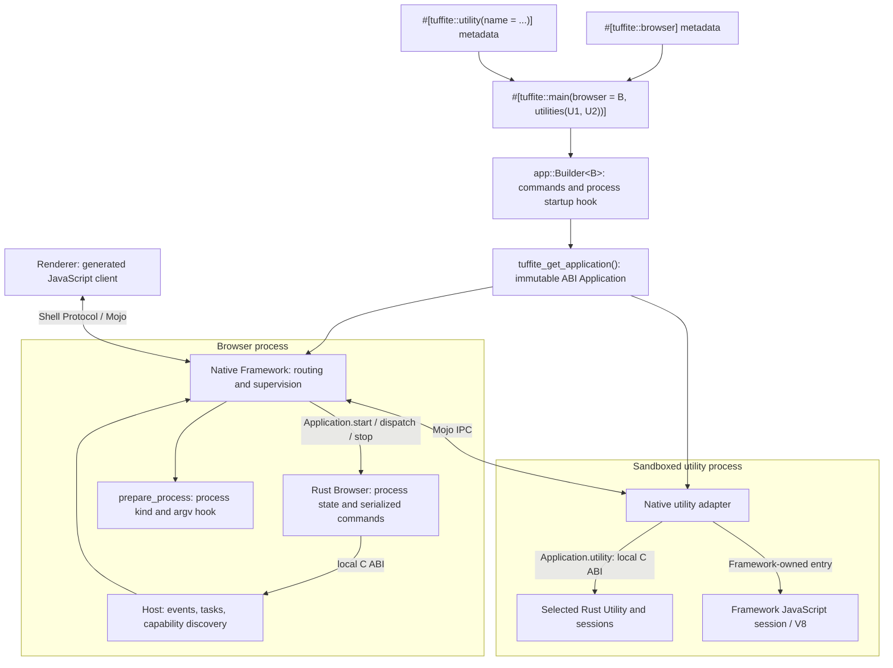
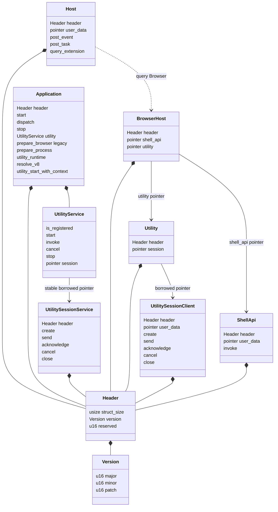
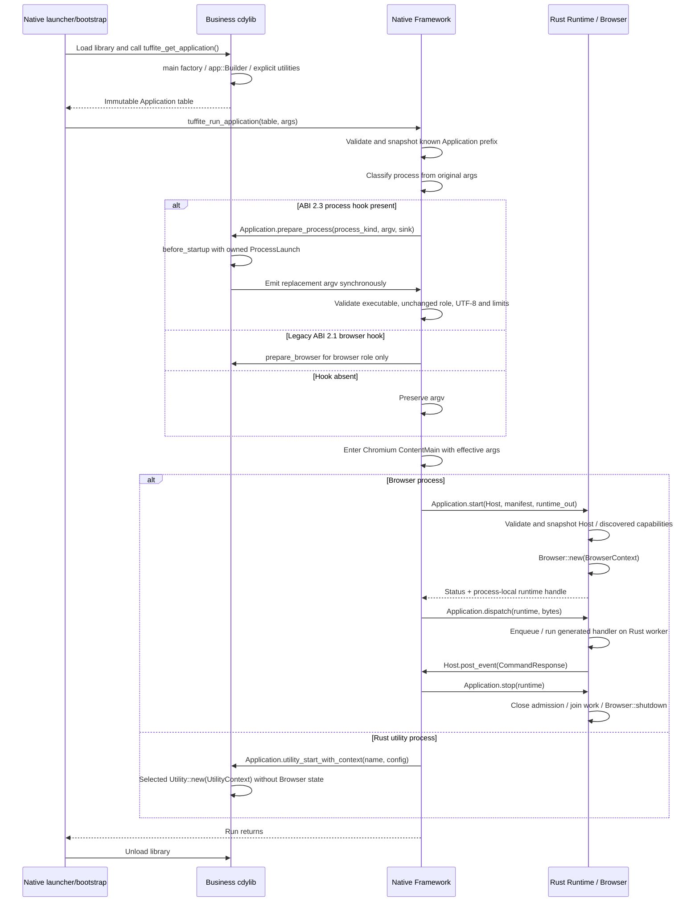
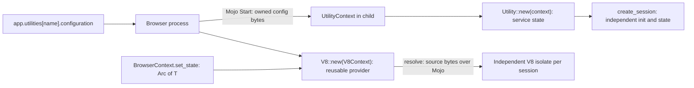
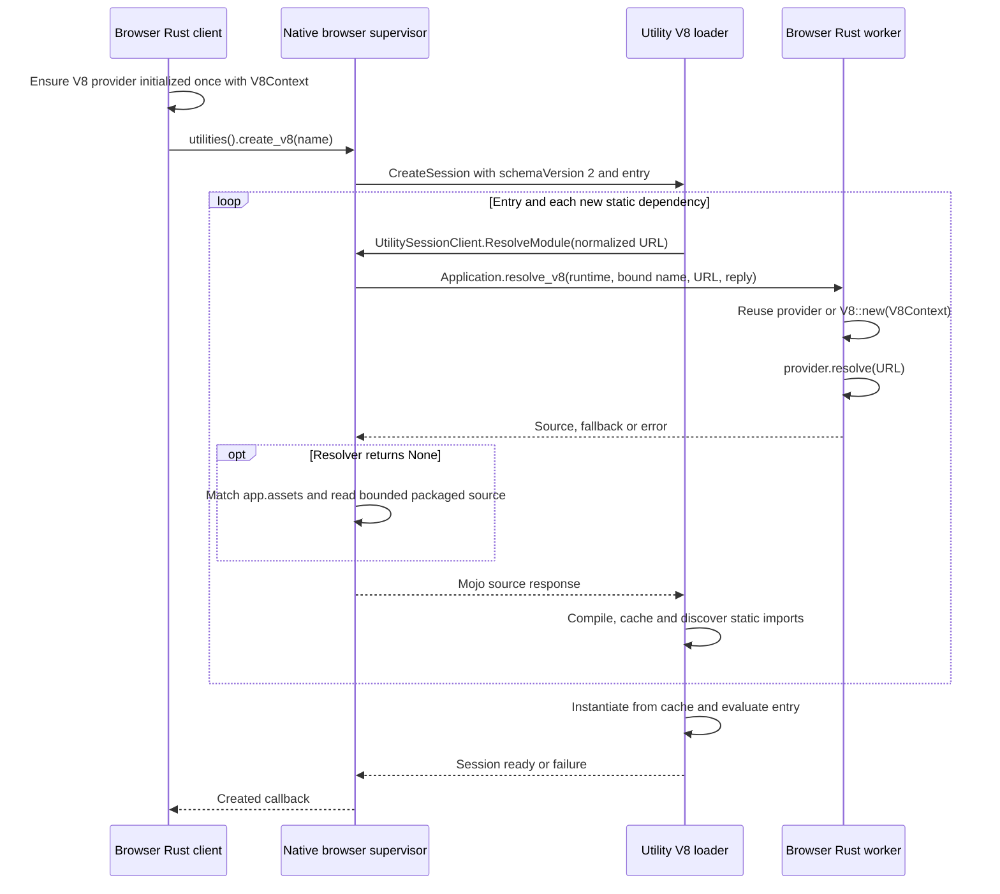
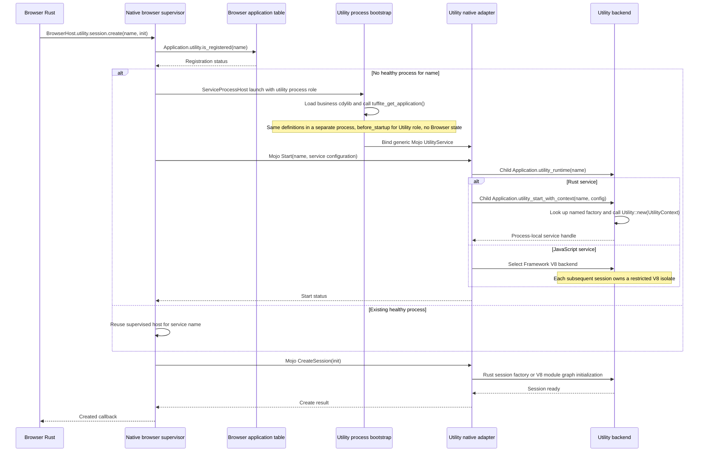
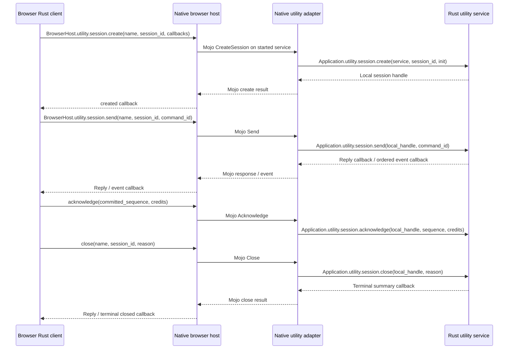

# Tuffite ABI

`tuffite-abi` defines the C-compatible binary contract between the native Chromium
Framework and an application's Rust runtime library. It contains declarations,
version checks, and layout tests; it does not implement Chromium integration,
service routing, application policy, or the safe SDK.

Application developers use `tuffite`. Runtime and Framework maintainers use this
crate and the matching [C header](../../framework/public/abi.h).

## Layers and process boundaries



The C ABI crosses a language/library boundary **inside one process**. Mojo crosses
process boundaries. Callback pointers and `user_data` never travel over Mojo.
The application library is loaded separately in each relevant process; its
handles and global state belong to that process.

| Layer | Responsibility |
| --- | --- |
| `tuffite` | Safe application API, registration, generated exports, build helpers |
| `tuffite-runtime` | Rust application/service state, FFI validation, opaque handles, asynchronous callbacks |
| `tuffite-abi` | Stable C-compatible types, signatures, callback table layout and ABI version |
| Native Framework | Chromium lifecycle, task scheduling, browser routing, utility supervision, Mojo adapters |
| Mojo / Shell Protocol | Cross-process transport / application message envelope |

The ABI `MainDelegate` and `UtilityService` structs are callback tables. The safe SDK `#[tuffite::main]` selects process implementations; `app::Builder<B>`
assembles commands and launch hooks. `Browser` and `Utility` implement process-local lifecycles.
There is no safe Rust `MainDelegate` trait or application state object. These traits are not FFI structs.

## Callback table model

`Host` provides core native capabilities and discovery. `MainDelegate` provides
Rust implementation callbacks. `Host.query_extension(Browser)` discovers a
`BrowserHost` capability table, whose `shell_api` and `utility` fields point to
independently headed tables. These pointers are not inline fields of Host.
`BrowserHost` is the native capability aggregate; the safe `Browser` trait is
the application implementation selected by `#[tuffite::browser]`.



| Table/group | Implemented by | Called by | Purpose |
| --- | --- | --- | --- |
| `Host` | Native Framework | Browser Rust runtime | Native events, Chromium tasks and capability discovery |
| `BrowserHost` | Native browser Framework | Browser Rust runtime | Process capabilities grouped under Browser |
| `BrowserHost.utility` / `Utility.session` | Native browser Framework | Browser Rust runtime | Supervised remote sessions addressed by service name and routing ID |
| `BrowserHost.shell_api` | Native browser Framework | Browser Rust runtime | Generated native Shell API requests |
| `MainDelegate` | Rust application runtime | Native Framework | Startup, command dispatch, shutdown |
| `Application.utility` | Rust application runtime | Native utility adapter; registration also checked in browser | Registered service lifecycle and bounded request/response |
| `Application.utility.session` | Rust application runtime | Native utility adapter | Process-local service session implementation |

Every independently exchanged native table starts with `Header`. SessionClient
and ShellApi carry their own `user_data`, which need not equal Host's context.
`Utility` only exposes a session table pointer and needs no additional context.
Application embeds the unary `UtilityService` group. Its `session` points to an
independently headed, immutable `UtilitySessionService` table with stable storage
owned by the application provider. Native startup validates both known prefixes. This
indirection permits compatible session-table growth without moving Application
fields; the library and service table remain loaded until Framework run returns.

### Capability discovery and lifetime

`Host.query_extension(user_data, capability: u32)` returns `*const Header` or
null. ABI 2.2 introduces `Capability::Browser = 2`, matching
`TUFFITE_CAPABILITY_BROWSER`. The current Rust runtime queries only Browser:

```text
Host.query_extension(Browser) → BrowserHost
                               ├── shell_api → ShellApi
                               └── utility → Utility
                                             └── session → UtilitySessionClient
```

The native bridge retains the earlier IDs `ShellApi = 0` and `Utility = 1` for
older clients. New code uses the Browser hierarchy. The parameter remains raw
`u32`, so future or unknown IDs are valid input and return null.

The provider guarantees an aligned readable size prefix and a valid declared
known prefix. Runtime checks size first, then version and reserved fields before
copying its known table prefix. BrowserHost requires ABI 2.2; Runtime separately validates both child tables
and the nested session table.
Malformed advertised capabilities reject startup; an absent query, null result,
null child table, null session pointer, or null optional operation means that capability is
unavailable. Safe wrappers return `Unavailable` when the operation is missing.

Query is local, thread-safe and side-effect-free: it launches no process and
transfers no ownership. Native tables are immutable members of `AbiHostBridge`,
not temporaries on the startup stack. They and their contexts remain valid until
application stop completes. Runtime does not assemble a second combined callback
table. Core execution and
events hold a `NativeHost(Host)` snapshot; the Utility facade holds only its
`UtilitySessionClient` snapshot, and the Shell API facade holds only
`Option<ShellApi>`. Thin internal wrappers express accepted thread-safety and
context-lifetime contracts without duplicating ABI fields. No discovered raw
table pointers are retained. Querying an operation does not bypass that operation's permission or lifecycle checks.

### Client facade versus service implementation

Browser and utility processes each load an Application table. Calling the
browser copy's `Application.utility.session` directly executes against browser
Rust service state; it does not invoke the isolated utility-process copy.

```text
Browser Rust → BrowserHost.utility.session → native browser supervisor
             → Mojo IPC → native utility adapter
             → utility-process Application.utility.session → Rust service
```

`Utility.session` is the browser-side client entry, while
`Application.utility.session` is the utility-side implementation entry. Both ABI
calls are local; the native layer connects them across processes. Client calls
use service names/routing IDs and asynchronous creation. Implementation calls
use process-local service/session handles. Handles are not cross-process
references. Deliberately running a local service would be a different execution
policy with different isolation and failure containment.

Host is the native provider. Its Browser capability exposes the browser process
services; it does not construct application Browser state. A future Renderer
capability can use its own discovery ID without changing Host layout.

### Shared Shell API and Remoting

`ShellApi.invoke(channel, binary_arguments, reply)` uses the same schema, codec,
registry and native handler as a Renderer call. The safe `ShellApiHost` accepts
any generated `ShellApiRequest`; builtins live under `tuffite::shell_api`.
There is no feature-specific Remoting ABI table or separate JSON envelope.

```text
Renderer JavaScript → generated codec → Mojo Shell Protocol ─┐
Browser Rust → generated request → ShellApi C ABI ───────────┤
                                                           ↓
                          shared Router → handler → native service
```

The router selects a method; each handler validates arguments and its actual
caller context. Renderer calls carry a frame and document identity; native calls
carry an ApplicationContext and a stable application owner identity.
Native calls never impersonate a frame. Frame-dependent methods return
InvalidArgument without a frame. Renderer permissions/origin checks remain in
handlers and their existing dispatch boundary. Direct `remoting.injectInput`
requires the native Application context in its handler.

The invoke return is ABI `Status` for **acceptance**. Once accepted, exactly one
reply carries the separate RPC status vocabulary (raw `i32`) and a binary result.
RPC AccessDenied must never be interpreted as an ABI status with the same number.
Rejection retains reply-context ownership and must not invoke the reply.

```rust,ignore
use tuffite::shell_api::remoting;
context.shell_api().invoke(&remoting::Capabilities {}, |result| {
    // A generated RemotingCapabilities result, or ShellApiError.
    println!("{result:?}");
})?;
```

RemotingService currently lives in the browser process with dedicated input and
capture task runners. Its ordinary Shell API methods reach the same CRD backend
from Rust and JavaScript. Utility remains a separate facade because its session
transport exposes ordered events, credits, cancellation and supervised process
lifetime, rather than only unary method replies.

## Logical main and explicit process definitions

Application crates emit a business `cdylib`. The OS main belongs to the native
launcher. `#[tuffite::main]` marks a zero-argument definition factory, explicitly
selects the browser type and utility types, and exports one
`tuffite_get_application()`. It does not scan other modules or use linker
registration. `#[tuffite::browser]` marks a concrete Browser implementation;
each utility attribute emits named type metadata. The main macro checks
service names and duplicates at compile time. Only listed utilities are exported.

```rust,ignore
#[tuffite::browser]
impl tuffite::Browser for MyBrowser {
    // new, optional dispatch and shutdown
}

#[tuffite::utility(name = "indexer")]
impl tuffite::Utility for Indexer {
    // new, invoke, optional create_session and shutdown
}

#[tuffite::main(browser = MyBrowser, utilities(Indexer))]
fn main() -> tuffite::app::Builder<MyBrowser> {
    tuffite::app::Builder::new()
        .commands(tuffite::generate_handler![open_project])
        .before_startup(|launch| {
            match launch.process_kind() {
                tuffite::app::ProcessKind::Browser => {
                    launch.argv_mut().retain(|arg| arg != "--business-debug");
                }
                tuffite::app::ProcessKind::Utility => {
                    // Prepare utility-process arguments, without changing its role.
                }
                _ => {}
            }
            Ok(())
        })
}
```

The getter evaluates the factory once per loaded library in each process. The
factory only assembles definitions. It creates neither browser state nor utility
instances, and it does not run startup hooks. A failed or panicking factory is
reported and returns null; unwinding never crosses the getter ABI.

Generated commands take `&mut MyBrowser`. If no command table is configured,
the builder uses `Browser::dispatch`; a configured table replaces that method.
Browser state is `Send` and mutable command dispatch is serialized. Rust utility
state is `Send + Sync`, unary calls borrow `&self`, and session commands are
serialized within each session. Both backends use `#[tuffite::utility(name = ...)]`.
The implemented trait selects Rust (`utility::Utility`) or V8 (`utility::V8`);
`V8::entry(&self)` declares the entry path and `V8::resolve(&self, url)` supplies each requested source. Native creates the
V8 runtime, while Rust services implement new/invoke.

## Bootstrap and application lifecycle



The Framework copies `MainDelegate` before entering Chromium. The runtime copies
`Host` at browser startup. Copying does not extend function-code or context
lifetimes: the business library remains loaded until Framework run returns;
native callback contexts remain valid until browser stop completes.

### ABI 2.3 startup hook and named utility runtime

`.before_startup` runs before Framework enters Chromium `ContentMain`. The OS
process already exists, and sandbox bootstrap may have run, notably macOS
Seatbelt initialization. It is not a pre-spawn callback. `ProcessLaunch` exposes
read-only `process_kind()` and owned `argv()` / `argv_mut()`; it supplies no
BrowserContext or running services.

Native classifies original argv as Browser, Utility, Renderer, Gpu or Other,
then calls `Application.prepare_process(kind, argv, sink)` for each role. The
hook cannot change the executable or the original Chromium process type.
For an Other role, the exact original type string is preserved too. The concrete
utility service name is selected later by Mojo Start(name), so it is not part
of this early process context.

Arguments use borrowed UTF-8 ByteSlices, including the executable at index zero.
Rust edits owned strings and the synchronous sink copies each output. No
allocator ownership or borrowed pointer retention crosses the ABI. Arguments
are bounded to 4096 entries and 1 MiB total, with no NUL. Hook errors, panic,
invalid output or sink rejection fail startup and preserve the original vector.
An omitted hook preserves argv. Windows applies effective arguments to
Chromium CommandLine; POSIX passes them as argc/argv. Rust std::env::args()
continues to read the original OS argument storage.

ABI 2.3 appends `prepare_process` and `utility_runtime` after ABI 2.1's
`prepare_browser`. Native reads only size/version-supported prefixes. The old
hook remains browser-only for older providers, and the new hook takes precedence.
`utility_runtime(name, out)` returns the compiled backend discriminator: Rust=0
or V8=1. Unknown names reject. When that callback is absent, native uses the
legacy Rust selection and reserved JavaScript backend.

```rust,ignore
use tuffite::utility::v8::{Error, ModuleSource};

struct Parser;
#[tuffite::utility(name = "parser")]
impl tuffite::utility::V8 for Parser {
    fn new(context: tuffite::utility::V8Context) -> tuffite::ApplicationResult<Self> {
        // The provider can retain context and application-owned state.
        let _name = context.name();
        Ok(Self)
    }

    fn entry(&self) -> &'static str { "entry.mjs" }

    fn resolve(&self, url: &str) -> Result<Option<ModuleSource>, Error> {
        let source = match url {
            "myapp://parser.utility/entry.mjs" => include_str!("entry.mjs").to_owned(),
            "myapp://parser.utility/helpers.mjs" => std::fs::read_to_string("helpers.mjs")?,
            _ => return Ok(None),
        };
        Ok(Some(ModuleSource::new(url.to_owned(), source)))
    }
}
```

Both Rust and V8 types appear in `#[tuffite::main(..., utilities(...))]`.
`context.utilities().create_v8("parser", on_closed, on_created)` launches the
selected service lazily. Registration and creation encode only its entry path;
module I/O happens on demand. `ModuleSource` accepts embedded, file-loaded and
generated text. Rust resource resolution runs on supervised browser workers,
using a reusable provider instance constructed with `V8Context`. Browser-only typed
state and capabilities stay in that process; native owns a separate isolate per session.

### Context, instance state, and ABI 2.5 startup configuration

Rust services implement `Utility::new(UtilityContext)` inside their Utility
child process. The context owns the service name, service-local configuration,
and a cooperative `is_stopping()` signal. The application owns its instance
fields; `UtilityRequest` and `UtilitySessionRequest` carry independent request
and session data. Healthy children reuse the service; restarted children construct
new instances from the same startup configuration.

V8 resource providers implement `V8::new(V8Context)`, `entry(&self)` and
`resolve(&self, url)` in the Browser process. One provider is created lazily per
name per Browser runtime and reused across sessions. Construction is synchronized;
constructor errors or panic are retained until that runtime ends. Provider methods
can run concurrently, so mutable fields require locks or atomics. The context
provides `name()`, service `configuration()`, `application_configuration()`,
`executor()`, typed `state::<T>()`, and `is_stopping()`.

`BrowserContext::set_state(Arc<T>)` and `state::<T>()` share typed state with
providers within that runtime. Replacing a type affects future lookups; existing
Arc holders keep their value. No Rust object, Arc, or Browser capability crosses
IPC. Session-specific provider configuration is not part of this API: the current
resolver routes by service name and URL, without a session identity.

```json
{
  "app": {
    "utilities": {
      "indexer": { "configuration": { "mode": "incremental" } },
      "parser": { "configuration": { "language": "javascript" } }
    }
  }
}
```

This is a manifest fragment. `app.utilities` configures compiled registrations;
it does not register new services. Only the selected configuration value is
serialized for the child, with a 64 KiB limit; an omitted value is an empty byte
slice. Session init remains independent. ABI 2.5 appends
`Application.utility_start_with_context(name, configuration, service_out)`.
Native prefers it and preserves the ABI 2.0 start callback for older providers.
A nonempty configuration with a provider lacking this callback fails with
IncompatibleAbi instead of silently discarding configuration.



Browser shutdown closes provider admission and signals contexts before draining
workers. Utility stop signals its contexts before waiting for active operations.
Retained context clones observe the same signal; capabilities follow the owning
runtime's lifetime.

### ABI 2.4 on-demand V8 resources

ABI 2.4 appends `Application.resolve_v8(runtime, name, url, context, reply)`.
Acceptance returns OK and transfers callback ownership until exactly one reply;
rejection invokes no callback. Sources are borrowed during the reply and copied
by native. Workers are joined by browser stop before the business library unloads.
A panic becomes Internal; a resource error fails session creation.



The native session binds the service name; the child cannot select another
resolver. URLs are canonical `app-scheme://service.utility/path.mjs` resource URLs.
The application scheme is registered as a standard scheme by Framework.
Each service uses a distinct lowercase host (`parser.utility`, `indexer.utility`), and
registration rejects V8 names that collide after host case normalization,
therefore a distinct application resource Origin. Relative entry paths use this
namespace; absolute HTTPS and file entries are also supported. Chromium resolves
relative and absolute URL imports, including encoded paths, query and fragment.
Credentials, unsupported schemes, bare package imports and import attributes
are rejected. Custom-scheme requests must match the current application scheme
and the session-bound utility host. HTTPS/file requests still call the same
Rust resolver; they do not grant ambient network or filesystem access to V8.
The provider implements its own remote-origin or filesystem-root policy. Each module is requested once
per session, including cyclic/shared dependencies. Linking uses the compiled
cache synchronously; Mojo and resource I/O happen before linking. Limits are
64 modules, 512 KiB per source, 1 MiB total and a 30-second startup timeout.
A new session resolves fresh sources. Dynamic `import()` remains disabled.
The legacy schemaVersion 1 complete-graph envelope remains supported.
`context.utilities().sessions()` exposes binary Rust sessions; the old
javascript_extensions accessor is deprecated.

### Resolver override and app.assets fallback

`V8::resolve(&self, url)` returns `Result<Option<ModuleSource>, Error>` and defaults to
`Ok(None)`. Some(source) overrides assets; None replies with ABI 2.4 NotFound=7
and asks native to resolve the same URL through `app.assets`. An error or panic
fails loading and never falls back. An assets-only service implements `new(V8Context)` and `entry(&self)`;
`resolve` uses the default fallback.

Native shares `AppManifest::ResolveAssetFile` with the frontend URL loader:
Origin/path matching and packaged root rules are identical. Reading runs on a
native blocking worker with the same 512 KiB module bound. The loader forwards
no arbitrary HTTPS/file URL to the network or filesystem; those URLs need a
resolver result. A missing route/file fails session creation.

```json
{
  "origins": ["myapp://parser.utility"],
  "paths": ["/*"],
  "directory": "utilities/parser"
}
```

Add this route to `app.assets` and `utilities/parser` to `bundle.resources`.
The Playground exercises both branches: entry and sdk/runtime.mjs use assets,
while sdk/generated.mjs is supplied by its Rust resolver.

`RunFn` describes the Framework entry point. `tuffite_get_application` remains
the single business-library getter without a version suffix: its Application
table is an ABI aggregate, not a safe Rust Application implementation.

## Utility service and session flows

Registration records definitions, not running processes. Browser startup discovers
`BrowserHost.utility.session` and constructs a safe `UtilitySessionHost` facade.
The first `context.utility_sessions().create(name, ...)` request checks the
compiled registration via the **browser copy** of `Application.utility.is_registered`.
The native supervisor lazily launches a Chromium utility process and starts the
selected service there. The browser does not call `Utility::new(UtilityContext)` locally.
Renderer unary calls additionally pass the manifest service allowlist and Shell
API permission checks. Trusted Browser session calls use compiled registration;
the legacy reserved JavaScript service remains accepted for older callers.



A unary service uses `is_registered → start → invoke/cancel → stop`.
A long-lived session adds independent commands, ordered events, credit
acknowledgement and explicit close. After the loading path above, communication
uses the already running process and local session handle:



`session_id` is a routing identity; `Handle` identifies a local Runtime object.
`command_id` correlates commands, while event `sequence` tracks ordered progress.
Acknowledge events after the consumer's commit boundary, then replenish credits.
Cancellation is cooperative. Process failure and terminal closure are supervised
by the native host, not inferred from a raw Rust handle. See the detailed
[session contract](../../docs/utility-sessions.md).

## Data, ownership and execution rules

| Concept | Contract |
| --- | --- |
| `Status` | Stable numeric result; asynchronous acceptance is distinct from the eventual reply |
| `Handle` | `u64`, zero invalid; Runtime validates kind, slot and generation; process-local identity |
| `ByteSlice` / pointer + length | Borrowed bytes valid during the call; copy before retaining or crossing IPC |
| Function pointers | C calling convention; nullable callbacks use `Option<extern "C" fn>` / null |
| `user_data` | Opaque owner-managed context; validity and release follow the particular callback contract |
| Tasks | Accepted tasks invoke `run` and release task state with `destroy`; rejected submission retains caller ownership |
| Reply/event callbacks | Bounded work; validate/copy/enqueue before returning; avoid synchronous Runtime re-entry |

No Rust strings, trait objects, futures, vectors, or C++ objects cross the ABI.
Neither exceptions nor Rust unwinding may cross it; Runtime entry points contain
panics. Callback state must satisfy the declared thread-safety/lifetime contract.
Session host callbacks run on the browser sequence; blocking persistence belongs
on application worker execution. Acceptance/rejection and terminal callbacks
must be handled separately to avoid double-free or leaked callback contexts.

## Synchronization and deadlock boundaries

Static storage is an SDK choice, not a C ABI storage-class requirement. C
providers may own their immutable tables elsewhere, provided addresses and
function code stay valid until Framework run returns. The current Rust exporter
uses `&'static UtilitySessionService` because its exported Application table is
itself static. This requires no allocation, initialization lock or mutable state.

| Lock | Why it remains | Boundary |
| --- | --- | --- |
| Runtime/service/session handle tables | Concurrent FFI lookup and removal | Clone/remove objects under the lock; invoke callbacks and join after release |
| Application implementation | No lock: dispatch worker owns the application | Join returns ownership for shutdown on the stopping thread |
| Utility operation gate RwLock | Drain admitted unary/session creation operations before service cleanup | Close admission and cancel before waiting; release gate before user shutdown |
| Session implementation Mutex | Exclusive `&mut` command and close state | Credit acknowledgement/cancellation bypass this lock; no synchronous self-reentry |
| Session flow Mutex | Credit accounting, ordered event delivery and close barrier | Native event sinks copy/enqueue only; never synchronously acknowledge/reenter |
| Executor completion/pending locks | Cross-thread results and shutdown drain | Wake outside completion lock; condition-variable wait releases its lock |
| Supervisor task table | Concurrent supervised task spawn/cancel/stop | Drain under the lock; join after release |
| Native host-call admission lock | Worker submission races with browser shutdown | Run tasks and rejection replies after release; PostTask only enqueues |
| JS execution-control lock | Cancel/close race with isolate lifetime | Protect pointer through TerminateExecution; do not evaluate JS or destroy isolate under it |

Dispatch queue sender/worker handles have one owner after runtime-table removal, so they also need no locks.
Shell API pending replies are browser-sequence-owned and need no lock. Session
terminal callbacks have exclusive ownership after event delivery stops and also
need no lock. The immutable application registry uses OnceLock rather than a Mutex. `acknowledge` updates emitter flow control directly; it does not
call a mutable session hook while a pending command awaits credits.

Utility service state is already Send + Sync and is not wrapped in a data lock. Its operation gate only provides the shutdown barrier; session creation keeps that read gate until its handle is published so shutdown cannot miss it.

These boundaries prevent internal lock cycles; they cannot guarantee progress
for arbitrary application code. A handler/future that ignores cancellation,
awaits another command serialized behind itself, synchronously re-enters its own
session from an event sink, or waits for shutdown from work being joined can
still block. Utility commands must be bounded and cooperate with cancellation;
callbacks must copy/enqueue rather than wait for browser work. Shutdown does not
forcibly terminate Rust futures.

## Versioning and layout

[`Cargo.toml`](Cargo.toml) owns the independent ABI semver, currently `2.5.0`.
Rust derives `ABI_MAJOR`, `ABI_MINOR`, `ABI_PATCH` and `Version::CURRENT` from it.
[`scripts/abi.py`](../../scripts/abi.py) generates native `abi_version.h` and
provides the same version to Distribution packaging.

Host, BrowserHost, Application, Utility, UtilitySessionClient, UtilitySessionService and ShellApi start at offset zero with:

```text
Header = struct_size: usize + Version { major, minor, patch }: 3 × u16 + reserved: u16
```

`Header::for_type::<T>()` records the **complete provided table** size. Providers must match the required major and satisfy its minimum
minor/patch version (stable semver caret semantics). Reserved bits must be zero;
size must cover every field the consumer reads. A non-null pointer and a claimed
size do not prove memory validity: callers still owe the documented pointer
contract.

- Major: incompatible layout, signature, ownership or behavioral contract changes.
- Minor: compatible capabilities appended to the outer table; old offsets remain fixed.
- Patch: compatible fixes with unchanged binary layout.

### Using the ABI version

Set the release in `crates/tuffite-abi/Cargo.toml`; do not maintain separate native
or Python version constants. When releasing a new ABI crate version, update the
SDK/Runtime dependency requirements and lockfiles, then regenerate/build native
consumers and package artifacts carrying that version.

```rust
use tuffite_abi::{Header, Host, Version};

// Provider: initialize the complete table prefix.
let header = Header::for_type::<Host>();
assert_eq!(header.version, Version::CURRENT);

// Consumer: choose the minimum binary capabilities it actually requires.
let required = Version { major: 2, minor: 0, patch: 0 };
assert!(header.version.is_compatible_with(required));
assert!(header.struct_size >= std::mem::size_of::<Host>());
assert_eq!(header.reserved, 0);

// Illustrative newer provider versus minimum requirement.
assert!(Version { major: 2, minor: 1, patch: 0 }.is_compatible_with(required));
assert!(!Version { major: 3, minor: 0, patch: 0 }.is_compatible_with(required));
```

The current Runtime and native bridge use `Version::BASELINE` (the original
`major.0.0` contract) for the tables they consume, rather than blindly requiring
`Version::CURRENT`. Providers still advertise their full crate release version.
This keeps a new compatible crate release from rejecting an older provider when
only baseline callbacks are required. ABI 2.1 adds the optional browser launch
hook while preserving the ABI 2.0 prefix. ABI 2.2 adds the Browser discovery
capability with child table pointers. ABI 2.3 adds the all-process startup hook
and named utility runtime selection. ABI 2.4 adds asynchronous V8 source resolution.
ABI 2.5 appends service startup configuration without changing existing prefixes. When Browser is absent, its safe facades
return Unavailable; the current runtime does not fall back to querying legacy IDs.
Version checks on a received raw pointer follow a size-first validation path;
do not dereference the complete table before validating its readable prefix.

```c
tuffite_abi_header header = tuffite_abi_header_for_size(sizeof(tuffite_host));
tuffite_abi_version required = {2, 0, 0};
int compatible =
    header.struct_size >= sizeof(tuffite_host) && header.reserved == 0 &&
    tuffite_abi_is_compatible(header.version, required);
/* Actual consumers reject an incompatible table before calling its entries. */
```

| Provided / required | Accepted? | Reason |
| --- | --- | --- |
| `2.0.0` / `2.0.0` | Yes | Exact minimum |
| `2.0.2` / `2.0.1` | Yes | Sufficient patch |
| `2.0.0` / `2.0.1` | No | Insufficient patch |
| `2.1.0` / `2.0.2` | Yes | Greater minor |
| `3.0.0` / `2.0.0` | No | Different major |

### Extending capabilities without shifting Host

Host's discovery slot and Utility's session pointer have fixed size. Appending
session callbacks therefore does not move Host, Application, Utility or ShellApi fields.

| Change | Version/layout rule |
| --- | --- |
| Implementation fix | Patch release; preserve contract and layout |
| Optional capability ID or appended optional table fields | Minor release; retain existing IDs and offsets |
| Changed signature, field order, ownership, removed callbacks | Major release |
| Existing payload protocol extension | Negotiate its protocol/capabilities without silently reinterpreting old messages |

There is one ABI crate semver, not one independently maintained counter per
facade. All provider Headers use that release. A consumer checks the minimum
version and readable prefix required for the capability it actually uses. New
capabilities may require a newer minimum without raising the minimum for Host's
unchanged baseline. Unknown query IDs return null, enabling fallback.

Current validators copy only their known fixed prefixes and ignore a newer
provider's extra tail. When introducing a new **optional** tail field, add a
size-gated reader and fallback; do not replace that path with an unconditional
copy of the enlarged type. A new consumer must not read newer fields from an old
table. Keep header, context and existing callback offsets unchanged.

Application's unary UtilityService remains inline, so adding fields there can
shift Application layout. Its independently headed session table can append
optional callbacks with size-gated reads. Pointer indirection protects both
client and service session tables; changing existing signatures or ownership
still requires a major release.

This refactor directly finalizes the unpublished ABI 2.0 shape; there is no
compatibility shim for the earlier interim inline Host layout.

Framework release/Distribution metadata and application configuration schemas
have their own contracts; they are not the ABI version. ABI 1 artifacts must be
rebuilt for the ABI 2 getter and contract.

## Implementation and validation map

| Source | Role |
| --- | --- |
| [`src/lib.rs`](src/lib.rs) | Rust ABI declarations, semver and layout tests |
| [`framework/public/abi.h`](../../framework/public/abi.h) | Matching native C declarations |
| [`abi.rs`](../tuffite-runtime/src/abi.rs) | Validate Host, application lifecycle and FFI guards |
| [`shell_api.rs`](../tuffite-runtime/src/shell_api.rs) | Generated native requests, acceptance ownership and RPC response decoding |
| [`utility_host.rs`](../tuffite-runtime/src/utility_host.rs) | Safe browser Rust client and callback ownership |
| [`utility_entry.rs`](../tuffite-runtime/src/utility_entry.rs) | Process-local utility/service FFI implementation |
| [`abi_host_bridge.cc`](../../framework/app/abi_host_bridge.cc) | Native table validation and browser Host callbacks |
| [`utility_service.cc`](../../framework/utility/utility_service.cc) | Native utility adapter between Mojo and Application callbacks |

Run `python3 x.py test --suite framework --non-interactive` from the Framework
root for generation checks, browser tests, Python tests, Rust tests, formatting
and Clippy. ABI changes also require native consumer compilation and C layout
checks. Cross-process behavior requires the native/packaged smoke suites;
compilation alone does not prove those runtime flows.
