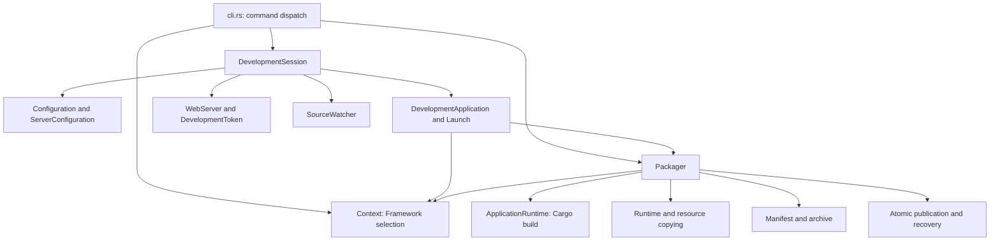

# Framework development

The outer workspace owns tools and checkout pins. This repository owns the
Framework, developer tasks, and downstream patch series. Application developers
use `tuff`; Framework developers use `python3 x.py` and `cargo spo`.

## First checkout

At the outer workspace root:

```sh
mise trust
mise run setup
```

Mise prepares Rust, Python, sccache, and the pinned Depot Tools submodule.
gclient checks out the pinned Framework and its Chromium dependency. Its hook
runs `python3 x.py bootstrap`, which builds/runs spo to apply patches. Rust must
therefore be installed by `mise run setup` before checkout. No global binary
installation or Cargo alias discovery is required. Native platform prerequisites (Xcode or Visual
Studio Build Tools, and Linux build dependencies) remain platform prerequisites.

Activate the outer Mise environment, then work from `src/tuffite`:

```sh
cd src/tuffite
python3 x.py build --run
cargo spo
```

The aliases compile the current tool sources incrementally. Global installation
is unnecessary. If Mise is not activated, prefix commands with `mise exec --`.
Rust versions in the outer Mise configuration and `rust-toolchain.toml` must agree.

Menus separate command names and descriptions with color. Press `/` to filter
using subsequence matching, ↑/↓ to move, and Enter to accept. Esc clears an active
filter; Esc outside filtering or Ctrl-C cancels. File selection in `spo new`/`refresh` supports Space to
toggle multiple files; choices stay selected when the filter changes. Explicit
arguments bypass menus, and non-interactive mode never reads terminal input.
The outer Mise tasks prepare checkouts and forward `framework`, `dev`, `tuff`,
and `www` commands. Framework operations remain implemented in `x` and `spo`.

## Daily tasks

```sh
python3 x.py                         # Show help
python3 x.py build                   # Build local Framework + Playground
python3 x.py build --run              # Build and run with Vite HMR
python3 x.py build --framework         # Compile native targets only
python3 x.py build --target tuffite/framework:unittests
python3 x.py compdb                   # Refresh clangd's compilation database
python3 x.py test --suite framework   # Bindings, JS tests, Rust tests, formatting, Clippy
python3 x.py test --suite native      # Build and run native unit tests
python3 x.py test --suite smoke       # Package and run Playground integration smoke
python3 x.py test --suite explorer    # Package and run the detailed Explorer CDP smoke
```

The macOS Explorer CDP suite checks the native context-menu enable/disable
policy. AppKit menu interaction requires native OS input rather than CDP
renderer key events, and is reported separately as untested by this suite.

Build defaults to Playground and the release profile. Native CPU selection uses
an existing output's `target_cpu`, then the host architecture; pass `--target-cpu`
to override. Non-interactive runs ignore the existing output's CPU: specify profile
and CPU in CI. There are no saved menu preferences. Outputs remain separate by profile.

`python3 x.py` is the sole Framework entry and prints help without arguments.
The implementation lives in `scripts/` and uses only the Python standard
library; no pip installation, venv, or interactive menu is required. Missing required
arguments show a usage error. Upload confirms with `[y/N]`; pass `--yes` in CI.
Ninja defaults to two thirds of logical CPU cores (rounded down, at least one).
Use `-j N` or `--jobs N` to override it.

Application builds receive an explicit locally packaged Framework directory and
have automatic downloads disabled. C++ changes cannot silently launch against a
remote Distribution. Rust and Web development continue through the application
CLI; Framework Rust or C++ changes can be incorporated by rerunning the build.
Uncommitted and unexported changes are allowed during incremental builds.

To diagnose an unexpectedly broad native rebuild, use
`python3 x.py build --profile release --explain` before rebuilding. It runs
`ninja -d explain -n` against the existing graph without rewriting GN arguments.
Ninja may still regenerate an outdated graph when GN inputs change; a
`Regenerating ninja files` line alone does not mean C++ is being rebuilt. Inspect
the subsequent object-file reasons and CXX commands. This command does not compile
or package native targets. Select the same `--profile`/`--chromium-out` as the
affected build. `--target` can narrow the report. A normal `--dry-run` prints
the workflow instead; it does not inspect Ninja dependencies.

Ninja scheduling and compiler caching are separate: `command line changed`,
missing dependencies, or newer headers explain why Ninja schedules work;
`sccache --show-stats` reports whether those compiler invocations were cached.
Compare the output path, `args.gn`, compiler/Windows SDK versions and sccache
version before assuming a service edit invalidated the entire cache. Moving a
checkout, changing profile or target CPU, or updating toolchains can affect a
much larger graph than an implementation-only edit.
When validating a different target CPU, use a separate `--chromium-out`
directory so the check does not replace the normal build's arguments and outputs.

After renaming a checkout or output directory, a long-running sccache server
can retain the compiler's old absolute path even when Ninja invokes it through
the same relative path. A fatal spawn error naming the removed directory is
resolved by restarting the server with `mise exec -- sccache --stop-server`
and `mise exec -- sccache --start-server`, then retrying the build. Wait for
other builds to finish before restarting; the disk cache does not need clearing.
The workspace sets `SCCACHE_IDLE_TIMEOUT=0`, so the service can otherwise retain
this state indefinitely.

On Windows, `x.py` adds the absolute Chromium checkout path to sccache's C/C++
cache identity (preserving any user cache-buster value). Cached `/showIncludes`
output can contain absolute compiler-header paths; replaying an old checkout's
paths makes Ninja repeatedly schedule objects whose recorded headers no longer
exist. A move may require one fresh compilation of affected objects. The shared
cache is retained, and subsequent builds at the same path reuse the new entries.
Direct Ninja invocations do not receive this environment setting; use `x.py`
consistently for builds and packages.

If `--explain` still reports headers under a previous checkout, first probe one
object instead of deleting the shared cache. In Git Bash on Windows, from
`src/tuffite`:

```sh
mv ../out/TuffiteRelease/obj/base/base/base64.obj ../out/TuffiteRelease/obj/base/base/base64.obj.probe-backup
SCCACHE_RECACHE=1 mise x -- python3 x.py build --framework --target obj/base/base/base64.obj
../third_party/ninja/ninja.exe -C ../out/TuffiteRelease -t deps obj/base/base/base64.obj | grep cronymax
../third_party/ninja/ninja.exe -C ../out/TuffiteRelease -t commands -s obj/base/base/base64.obj
```

Replace `cronymax` with the previous checkout name. First inspect the object's
dependencies and select an object that actually contains the old paths; replace
`base64.obj` throughout if needed. Moving that one object aside forces Ninja to
rebuild it, bypassing and replacing its cached result. Without this step,
`SCCACHE_RECACHE=1` does nothing when Ninja reports `no work to do`.
The backup is retained until the probe succeeds. If the old paths disappear
after an otherwise unchanged compile, cached output is implicated. If they
remain, inspect the actual compiler command, include/resource paths and any
filesystem links to the previous checkout. Windows builds print the checkout
and cache identity so missing or outdated path isolation is visible. Keep
`.ninja_deps`, object files and the shared cache until the cause is established.

## Framework naming and Distribution identity

Native implementation lives under `framework/`. The shared GN target is
`//tuffite/framework:framework`, with output `libtuffite.dylib`, `libtuffite.so`, or
`tuffite.dll` and `tuffite.dll.lib` on Windows. Packaging uses
`tuffite-framework.json`, local directories such as
`dist/tuffite-framework-macos-x64`, and Release assets named
`tuffite-framework-<rust-target>.zip`. Rebuild and repackage after this migration;
previous artifacts are not renamed or treated as compatible.

| Setting | Purpose |
| --- | --- |
| `TUFFITE_FRAMEWORK_DIR` | Framework source checkout for local development |
| `TUFFITE_FRAMEWORK_DIST` | Exact extracted Distribution; takes precedence |
| `TUFFITE_FRAMEWORK_DIST_TARGET` | Explicit Rust target triple |
| `TUFFITE_FRAMEWORK_DIST_CACHE` | Versioned cache root |
| `TUFFITE_FRAMEWORK_DIST_DOWNLOAD_DIR` | Exact managed download destination |
| `TUFFITE_FRAMEWORK_DIST_AUTO_DOWNLOAD` | Enable/disable download on a cache miss |
| `TUFFITE_FRAMEWORK_DIST_PROGRESS` | Enable/disable transfer progress |
| `TUFFITE_FRAMEWORK_DIST_RELEASE_TAG` | Override the Release tag |
| `TUFFITE_GITHUB_REPOSITORY` | Release repository as owner/name |

The Rust build API is `tuffite::build::framework::Resolver` with
`tuffite::build::Builder::new().add(resolver)`. Applications use
`#[tuffite::main(browser = PlaygroundBrowser)]` and `tuffite::generate_handler!`.
Binding generation and Framework resolution/download run automatically in
`tuff dev`, `tuff build`, and `tuff package`; no separate generate/download
command is needed. Use `tuff framework verify <distribution>` to verify an
existing Distribution. The ABI has two directional tables: `Host` / `tuffite_host` provides native host
callbacks; `Application` / `tuffite_application` provides Rust application entries.
Both tables begin with `Header { struct_size, version: Version, reserved }`.
`Host.query_extension(Browser)` discovers `BrowserHost`, whose `utility` and
`shell_api` fields point to independent facade tables. `Utility.session` points to a separately sized `UtilitySessionClient`;
each callable native table has its own context. Unknown capability IDs return
null. These borrowed immutable tables remain valid through application stop,
and Runtime validates and snapshots their known prefixes. Host's core layout
does not grow when a facade gains optional operations.
`Application.utility` still embeds the ABI `UtilityService` lifecycle callbacks
and an independently sized `session: &'static UtilitySessionService` table. The safe Runtime
`#[tuffite::browser]` marks the Browser implementation; `#[tuffite::main]`
selects that backend and explicit utility types;
`Browser` and `Utility` implement their respective process lifecycles. See
[the application model](architecture.md#8-application-model).
The directional tables share version/size checks but are not interchangeable. The dynamic getter is
`tuffite_get_application`; table names do not carry version suffixes.
See the [ABI architecture and lifecycle guide](../crates/tuffite-abi/README.md)
for table ownership, process boundaries, and session flows.

Distribution metadata and file layout follow `framework_version`, the Framework
release version. The SDK requires its matching release; there is no separate
Distribution schema counter. Keep required fields, safe paths, file hashes,
target checks and ABI semver checks when evolving the manifest. Breaking layout
changes require a Framework release version change. Application configuration
schema versions describe a separate user-facing contract.

`crates/tuffite-abi/Cargo.toml` owns the independent ABI crate version (currently
`2.5.0`). Rust derives `ABI_MAJOR` / `ABI_MINOR` / `ABI_PATCH` from Cargo's package version;
GN generates `abi_version.h` from the same manifest; Python packaging reads it
through `scripts/abi.py`. Workspace/application releases do not change the ABI
version implicitly. Major releases change the binary contract, minor releases
append compatible capabilities, and patch releases preserve the layout. A
provider must match the required major and satisfy the full minimum semver
version (equivalent to `^2.0.0` for this ABI); patch versions need not be identical.
Consumers require `Version::BASELINE` for the original known prefixes, not
unconditionally `Version::CURRENT`; new optional fields need size/version checks
and fallback. Provider `struct_size` describes its complete table; consumers read
only the prefix they require. Removing the getter's `_v1`
suffix requires ABI 2, so ABI 1 Distributions and application libraries must be
rebuilt and repackaged together.

## Branch changes and rolls

After switching or updating the Framework branch:

```sh
python3 x.py roll
```

Roll consumes the current Framework's DEPS and checked-in patch files. It uses
gclient with the Framework solution unmanaged and explicit dependency revisions;
the current Framework branch is preserved. An unchanged previously successful
roll is a no-op. It never upgrades Chromium implicitly.

```sh
python3 x.py roll --dirty stash                  # Preserve native WIP
python3 x.py roll --patches local --dirty stash  # Export local commits before syncing
python3 x.py roll --chromium-revision <full-sha> # Update the sole Chromium pin in DEPS
python3 x.py roll --dry-run                      # Inspect the plan
python3 x.py roll --continue                     # Resume after resolving a failure
python3 x.py roll --skip-hooks                   # Patch iteration with an already prepared toolchain
python3 x.py roll --abort                        # Restore original target stacks/pins
```

Checked-in files and local commits can differ after a branch switch. Choose the
source deliberately: the default replays checked-in files and preserves the old
local stack under backup refs. `--patches local` exports commits on the original
base before rolling. Inspect the Framework diff before committing either result.

Use `--skip-hooks` only when the toolchain and dependency outputs are already
prepared, for example when replaying patches without changing Chromium's revision.
It also works with `--continue` before hooks finish. This does not record a complete
toolchain receipt; a later normal roll still runs hooks when required.

Roll saves target stacks, synchronizes without hooks, runs the other gclient
hooks with the patch hook deferred, and applies patches through spo. Git conflicts
and WIP restoration are separate recoverable phases. If WIP restoration conflicts,
resolve it and use `python3 x.py roll --continue --wip-restored`. If interruption happened
while saving WIP, inspect the actual stash and use `--continue --wip-saved <oid>`.
The stash's original parent must match the saved HEAD.

Abort restores target stacks and version declarations. It is not a transaction
across every dependency managed by gclient: other dependencies may still need a
sync. New working changes or externally moved branches are never reset silently.

## Chromium changes and patch files

Changes under this checkout are committed here directly. Chromium-owned changes
are authored in the parent Chromium repository, then exported into this checkout.
Preserve the existing GN/buildflag and TUFFITE boundary requirements in AGENTS.md.

```sh
cargo spo                       # Status, target selection, and actions
cargo spo status --all
cargo spo new chromium --message "area: change" --paths path/to/file --export
cargo spo refresh chromium --patch feature.patch --paths path/to/file --export --dirty stash
cargo spo export --all --verify-apply
cargo spo check --all            # Semantic content/order + replayed tree
cargo spo check --all --strict   # Also require canonical serialized output
```

`new`/`refresh` commit only selected files; unrelated staged files are preserved.
Export reads committed HEAD and does not commit WIP. Normal export can leave WIP
in place; `--dirty stash` explicitly saves/restores it. Export stages output before
publishing. Replay verification uses a temporary sparse worktree containing only
files touched by patches, while comparing the complete resulting Git tree.

Each configured target has its own repository, base, patch directory, and state.
The committed `patches/config.json` maps targets to workspace-relative paths.
A target uses `base` for an explicit revision or `base_ref` for a Git ref; spo
has no knowledge of DEPS or Chromium. Tuffite uses `refs/spo/upstream` to record
the baseline of the currently applied stack. This is local derived state, not a
second version declaration. The first-checkout hook and successful roll update it.

The outer `.gclient` declares only the pinned Framework solution. Framework DEPS
is the sole source of the Chromium URL and desired revision; gclient follows its
`src` dependency and `recursedeps`. `x roll` reads that desired revision and passes
it to spo's library as the new base. After switching Framework branches, the old
Git baseline remains valid for exporting local commits until the roll completes.
`--chromium-revision` changes DEPS only. Standalone spo users can put their chosen
base directly in config, without involving gclient.

Git does not clone this private ref or local association/recovery journals. They
are derived state: a new device runs the first-checkout hook (or `python3 x.py roll`)
and records the baseline after replaying the committed patches. Do not copy
`.git` metadata between machines. When a first apply stops before creating its
ref, `spo continue`/`abort` recover the base from that operation's journal.
When `refs/spo/upstream` is missing, spo first checks its operation journal,
snapshot, and legacy baseline ref. With no local metadata, it can reconstruct the
baseline only when the complete applied commit sequence matches the checked-in
mailboxes by patch ID (including multi-commit mailboxes). Unexported commits do
not trigger a guess. `--dry-run` performs this inspection without creating refs.
If automatic recovery cannot prove the baseline, supply a known upstream commit:

```sh
cargo spo --base chromium=<known-upstream-sha> status chromium
python3 x.py roll --continue  # Resume an existing roll after recovery
```

`--base` validates ancestry and initializes only a missing private ref; it refuses
to replace an existing baseline or initialize during an active Git operation.
For a first checkout, `x.py roll` can initialize from the DEPS revision after
validating ancestry. Standalone spo users can commit `base` in config or maintain
their chosen `base_ref`; Tuffite's DEPS resolver belongs to `x`, not generic spo.

Target `exclude` entries are literal repository-relative paths. They apply to
WIP inspection, interactive file discovery, and stash selection as well as patch
ownership checks. The Chromium target excludes `tuffite`, so the nested Framework
checkout and its WIP do not require `--dirty stash` or local ignore-file edits.
Stash saves the selected owned paths, including staged and untracked changes;
ignored or excluded nested checkouts remain in place.

After the Cermet → Tuffite rename, the Framework checkout must be at
`src/tuffite`, matching the outer `.gclient`, `patches/config.json`, and GN
`//tuffite` labels. Updating sources inside an old `src/cermet` checkout does not
migrate its directory. On Windows this mismatch can appear as OS error 3; it is
a checkout-layout error rather than an empty patch series. spo now reports the
configured directory or manifest instead of showing `Patch files: 0` for an
unreadable manifest. Both the CLI and the x.py bridge validate missing patch
directories before starting new operations.

Finish pending roll/spo operations before relocating a checkout; keep their
journals. Update the outer workspace configuration and move the Framework
checkout to `src/tuffite` only if that destination does not already exist, then
run `python3 x.py roll` and `cargo spo check chromium`. Do not hide the mismatch
with `--dirty stash` or create an empty `.patches` file.


`.patches` lists mailbox filenames in order. A mailbox may contain multiple
consecutive commits. Grouping preserves commit history; squash/fixup changes it.
There are no Spo-Id trailers or extra committed identity manifests.

```sh
cargo spo group chromium --patch feature.patch --commits <sha1> <sha2>
cargo spo edit chromium
```

The plan uses `action commit filename` rows. Supported actions are `pick`,
`reword`, `edit`, `squash`, `fixup`, and `drop`. Reorder rows to reorder commits.
Every commit must appear once; deletion requires `drop`. Group filenames must be
contiguous; fixup/squash must follow a retained commit in the same group. Arbitrary
`exec` and merge commits are not supported. Editing/splitting at an `edit` pause is
supported; checkpoints recover the resulting group's commits after continuation.

Commit-to-file associations are local Git state. If history is rewritten outside
spo and association is ambiguous, explicitly reassociate with `group`, or import
the committed series into a fresh branch. Never infer grouping from subjects alone.

```sh
cargo spo continue chromium
cargo spo abort chromium
cargo spo continue chromium --wip-restored
```

The Rust first-checkout hook uses the same spo journal as later operations; spo
can continue or abort these without a separate recovery format. Saved WIP uses exact object IDs and is
removed only after successful restoration. Resolve WIP conflicts before confirming
`--wip-restored`; this confirmation does not discard conflict contents.

After exporting, review and commit `.patches` and mailbox files in this Framework
repository. Do not commit `tuffite/` paths into a Chromium patch commit.

## Packaging and publishing

```sh
# Build, verify, and upload in one operation.
python3 x.py package --profile release --target-cpu x64 --upload --repo OWNER/NAME --tag v0.1.0 --create

# Or inspect the package before uploading; both commands share path defaults.
python3 x.py package --profile release --target-cpu x64
python3 x.py upload --profile release --target-cpu x64 --repository OWNER/NAME --tag v0.1.0

# Custom paths use the same option on both commands.
python3 x.py package --distribution dist/my-framework --skip-build
python3 x.py verify dist/my-framework
python3 x.py upload --distribution dist/my-framework --repository OWNER/NAME --tag v0.1.0

cargo run --package tuffite --bin tuff -- package --manifest playground/tuffite.json
```

Packaging builds incrementally by default. `--skip-build` packages existing
native output. `package --upload` uploads only after packaging and verification
succeed; a failed upload leaves the package available for retry with `upload`.
Standalone `upload` verifies an existing Distribution and never builds it.
Both commands accept `--distribution` (with `--destination` as an alias), relative
to the Framework checkout. If omitted, the path is
`dist/tuffite-framework[-PROFILE]-PLATFORM-CPU`; release omits the profile suffix.
Use matching `--profile` and `--target-cpu` when packaging and uploading separately,
particularly for cross-platform artifacts or CI. A custom output directory must
also be supplied when uploading; the commands do not remember the last package.

Use `--create` to create a missing release and `--replace` to replace an existing
asset. Upload options on `package` require `--upload`. `--repository` (alias `--repo`) defaults to
`TUFFITE_GITHUB_REPOSITORY`, then `tuffite/tuffite`; `--tag` defaults to
`TUFFITE_FRAMEWORK_DIST_RELEASE_TAG`, then `v<Framework version>`. The upload plan
prints the resolved path, repository and tag before confirmation. Authentication
uses GITHUB_TOKEN, GH_TOKEN, or an already authenticated optional gh CLI.
Download/resolve/verify capabilities live in `tuffite::build::framework` behind
its `build` feature and are reused by `tuff dev`, `tuff build`, and `tuff package`.
Framework upload uses Python; there is no xtask crate.

Packaging strips staging copies by default; native build output stays intact.
Use `--no-strip` for diagnostic runtime packages and `--symbols-dir` to retain
private, matching symbols outside the runtime Distribution:

```sh
python3 x.py package --profile release --target-cpu x64 --skip-build --symbols-dir dist/symbols/framework
cargo run --package tuffite --bin tuff -- package --manifest playground/tuffite.json --format dmg --symbols-dir dist/symbols/playground
```

The Framework and application commands export their own symbols separately.
Archive and retain those directories with the build/release artifacts; normal
Framework upload publishes only the runtime Distribution. `symbols.json` records
target, original/runtime SHA-256, and macOS image UUIDs. On macOS, the export also
contains `.dSYM` bundles; keep the original build objects available while running
`dsymutil`. If an output directory was moved, relink cached libraries or use
`dsymutil --object-prefix-map OLD=NEW` when regenerating their `.dSYM` files.
Missing-object warnings mean source-level information may be incomplete;
the exported original binary is still retained. Windows exports existing PDBs
without modifying PE code. Linux keeps
unstripped binaries. Symbols export preserves information present in the build;
use a Framework profile with symbols and Rust release `debug = 1` or higher when
source-level crash diagnostics are required.

Playground supports `--format zip` (default), `directory`, and macOS `app`/`dmg`.
Windows `exe` automatically downloads and caches pinned NSIS through `tuff`, and creates a per-user installer
with an uninstaller and Start Menu shortcut. Installer creation requires its
native host. macOS bundles receive an ad-hoc signature for local validation;
public distribution still needs Developer ID signing and notarization. `.pkg`
is not currently supported. See [application packaging](build-and-distribution.md)
for icon overrides.

For applications developed beside this Framework checkout, set
`TUFFITE_FRAMEWORK_DIR` and leave `TUFFITE_FRAMEWORK_DIST` unset. Shared Distribution
resolution derives the local path from the requested target and profile and
checks its manifest. It prefers compatible local release output before the
versioned cache and download. Put machine paths in ignored `mise.local.toml`.
For a specific profile or exact artifact, use the existing `TUFFITE_FRAMEWORK_DIST`
there; explicit paths never fall back or get replaced.

## Automation

Every menu action has a corresponding command. `--non-interactive` disables
prompts and editors; missing choices fail with an actionable error. `--dry-run`
prints planned work without executing it. `--yes` accepts ordinary confirmations;
asset replacement still requires `--replace`.

```sh
python3 x.py roll --non-interactive --dirty reject
python3 x.py build --framework --profile ci --target-cpu x64 --non-interactive
cargo spo edit chromium --plan stack.todo --dirty reject --non-interactive
cargo spo export --all --verify-apply --non-interactive
cargo spo check --all --strict --non-interactive
```

An `edit` plan pauses on conflicts or an `edit` action even without a TTY; it does
not wait for input. Reword/squash need an editor and are rejected in non-interactive
plans. Resume after making the intended edits. Multiple targets complete in order;
a later failure does not undo an earlier target. Recovery journals belong under
Git's worktree-aware management directories, never in the patch manifest.

Outer `mise run framework -- <arguments>` forwards to this checkout's `x.py`.
`mise run dev` launches Playground and `mise run www` launches the documentation website.
Raw gclient remains available for diagnosis.

### Application CLI lifecycle

`cargo install tuffite --locked` installs `tuff` with the default `cli` feature.
Use `default-features = false` in application dependencies and enable only
`build` in build dependencies to omit CLI dependencies. The feature gates remain
so SDK consumers can opt out; source commands need no `--features cli`.

Each CLI invocation owns a context that resolves and caches one Framework
Distribution. `dev`, `build`, and `package` generate ShellAPI bindings and resolve
the Framework automatically. `dev --force-download-framework` refreshes the
managed Distribution once, then source-triggered rebuilds reuse that exact
selection for both native packaging and Cargo build scripts. Restart stops and
reaps the previous application before replacing its runtime library. `dev --prepare-only` performs the complete preparation without
launching the application or Web server. Framework C++/Rust code generation and
verification remain available under `tuff framework`.

A ShellAPI capability can use `"*"` to select every registered method for its
origins. This is a method selector; scoped operations still require explicit
path, URL, or window grants, and deny scopes continue to override allow grants.
Playground groups filesystem methods with `tuffite.fs.*` and window methods with
`tuffite.window.*`, retaining the narrower artifact, preview, and business-origin
capabilities. Namespace group resource scopes apply to resource-consuming
methods; unscoped methods in the group receive plain method grants. Groups that
have no scoped methods reject resource scopes. Resource-file read grants remain
separate because resource writes are forbidden.

The Rust CLI follows file-based module layout: `cli.rs`, `cli/dev.rs`, and
`cli/package.rs` are the entry files; their child modules live in the matching
directories. `DevelopmentSession` owns the shared Tokio runtime and restart/stop
decisions. `Configuration`, `DevelopmentApplication`, `WebServer`, and
`SourceWatcher` own project settings, native preparation/launch, server readiness,
and the per-generation source baseline respectively. `ServerConfiguration` is
the Web domain's input; `Launch` is the native application's input. A watcher
captures its baseline before the application launches and ignores build outputs
and symbolic links. Relative Web commands resolve against their configured cwd.

`Packager` coordinates the development/distribution mode and publication.
Its Cargo, runtime-copy, resources, archive, publication, and path domains live
in `cli/package/`; Cargo and archive records stay with their owning domain.
`ApplicationRuntime::build` handles Cargo metadata and build messages. Shared
filesystem validation lives in `cli/filesystem.rs`. State is owned by concrete
structs; reusable pure validation and copying operations remain functions.



## Native source formatting

Run `python3 x.py format` to format Tuffite-owned C++ and GN files with the
Chromium checkout’s pinned clang-format and GN tools.
`python3 x.py format --check` is read-only and works in CI; it also runs in
`x.py test --suite framework`. These commands include non-ignored new source
files. Format Chromium-owned patch targets in the parent checkout before
committing and exporting the patches with spo.

### Selecting a Framework release in build.rs

Resolver supports a custom GitHub repository and release tag. To use a managed
remote release rather than a local checkout or vendored Distribution:

```rust
let framework = tuffite::build::framework::Resolver::from_env()
    .expect("read Framework configuration")
    .managed()
    .repository("funelk/cermet-in-chromium")
    .release_tag("v0.1.1")
    .target("x86_64-apple-darwin");
```

Pass this resolver to `Builder::new().add(framework)`. `.managed()` clears local
Framework and Distribution overrides; automatic downloading must be enabled.
Custom repositories/tags have separate managed cache namespaces, so changing
either cannot silently reuse another release's cached artifact. A cache miss
downloads the release; subsequent builds reuse its verified cache. An explicit
`download_directory` is caller-managed and can be refreshed with
`force_download(true)`. The release tag can differ from the SDK version, but the
artifact's declared Framework version and ABI must remain compatible with the SDK.
