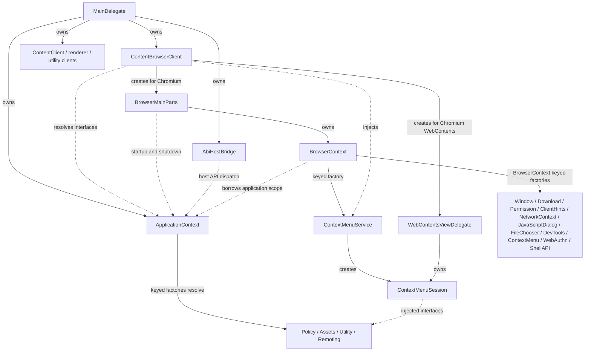

# Tuffite Framework

## Standard browser tab compatibility

The compatibility target for remote web content is a normal Chromium browser
tab's web-platform behavior, not content_shell's test defaults. Chrome layers
site permission prompts, profile settings, native UI and capability services on
top of Content. Using `WebContents` alone does not install those integrations.
content_shell is useful as an implementation reference, but it deliberately
auto-grants some test permissions and omits other production services.

The October 11, 2026 source audit distinguishes missing integrations from valid
Content defaults. No entry below is a demonstrated cause of a third-party
verification rejection.

| Area | Tuffite behavior | Work needed to match a normal tab |
| --- | --- | --- |
| Core page execution | Content/Blink supply navigation, frame isolation, workers, DOM, WebGL/WebGPU and origin storage | Retain engine behavior and regression-test embedding; don't reimplement the engine in services. |
| Current-tab navigation | Window implements `OpenURLFromTab`; Explorer retains navigation policy and events | Test renderer-initiated navigation, callback delivery and history for both surfaces. |
| HTML file inputs | `FileChooserService` supplies native single/multiple selection, directory upload and accept filters to Window and Explorer | Validate native platform selection, cancellation and document teardown; preserve Chromium's selected-file grants. |
| Permissions | Sanitized clipboard writes require current-document activation/focus; other permissions are denied | Add real supported capability backends, per-origin decisions, native consent UI, persistence/revocation and change notifications. A query must describe the actual policy, not imitate another browser's result. |
| Worker / embedded permission queries | Explicit denial rather than a shared site permission store | When a capability is supported, derive decisions consistently from origin, embedding policy, capability availability and stored choices; retain fenced-frame restrictions. |
| Notifications / push / background work | Platform notification, push, background fetch and background sync delegates are absent | Add separate capability services and OS integration before exposing grants; service workers and IndexedDB already work without these delegates. |
| Media capture / screen capture / audio output | Default WebContents delegate rejects unsupported media requests | Add device enumeration, consent, OS authorization, active-capture UI and shutdown handling. A permission prompt alone is insufficient. |
| Popup / new-tab routing | Window blocks ordinary new contents; Explorer emits policy-controlled open events | Add a browser-surface owner that adopts popup WebContents, preserves opener/partition/session state and applies popup policy. Retain the application's ability to intercept opens. |
| File System Access | No embedder permission context; Content permits picker-authorized reads and denies writes by default | Implement origin-scoped grants, sensitive-directory checks, write consent and handle restoration before claiming full writable support. OPFS is a separate origin-sandboxed facility. |
| Network profile policy | Encrypted persistent cookies and HTTP cache exist; language/compression preferences are configured | Add site cookie controls and explicit persisted HTTP server properties / transport security state where needed. Memory partitions are not a full incognito BrowserContext. |
| HTTP authentication / client certificates | Default login delegate and client certificate store/UI are absent | Add HTTP/proxy auth dialogs with request cancellation and client certificate selection; preserve strict TLS checks. |
| Browser presentation | JavaScript dialogs, context menus, download handling, fullscreen and picture-in-picture exist | Add color chooser, printing integration, browser shortcut/focus routing, load-error presentation and renderer-crash recovery. Downloads currently use profile-private destinations instead of a normal browser download UI. |
| Device APIs | No WebUSB/WebHID/WebSerial/WebBluetooth selection delegates | Add device-specific chooser and origin permission services as supported product capabilities. |
| Origin trials | No `ContentClient::GetOriginTrialPolicy` implementation or persisted trial controller | Choose and implement a legitimate trial-key/persistence policy; content_shell uses test keys, which are not a production replacement. |
| Optional BrowserContext delegates | Guest manager, special storage policy and SSL host-state delegate are null | These are permitted defaults. Their absence alone does not prove broken frames, storage or TLS. |

Keep lifecycle adapters (`ContentBrowserClient`, `BrowserMainParts`, Window and
ExplorerHost) thin. Capability state and native UI belong in keyed services.
Share services between ordinary windows and Explorer instead of adding a
second permission or dialog implementation to Explorer. A service must resolve
requests exactly once on selection, cancellation, navigation and shutdown.

Permission tracing can be enabled on a directly launched test application with
`--vmodule=permission_service_factory=1`. The log records permission type,
delegate entry point and returned state; it excludes origins, URLs and payloads.
Notification permission reads also have a separate Content fast path: without
a PlatformNotificationService, `Notification.permission` returns denied before
consulting the permission delegate. Compare both APIs when auditing consistency.

See [Explorer browser diagnostics](../docs/explorer.md#codex-browser-comparison)
for live comparison results and the distinction between evidence and hypotheses.

This directory owns Tuffite's production Chromium-side Framework. `app` composes
all process roles and connects the host application's ABI. `browser`, `renderer`,
and `utility` own their respective Chromium process adapters. Feature behavior belongs in `app/services/<service>` for application
capabilities and `browser/services/<service>` for browser/profile features.
Directory placement and keyed-service lifetime are separate: DevTools and context
menus use BrowserContext factories. Services expose public APIs
and keep implementations private.

`launcher` owns the thin executable entry and Windows sandbox setup;
`bootstrap.cc` and `runtime.cc` own the shared-library entries. `framework` is
the shared runtime library, and `distribution` aggregates the `tuffite_launcher`
template and runtime data. No production target depends on Content Shell or a
test-only target.

## Composition, Chromium adapters, and services

The browser integration class is named `ContentBrowserClient`, matching
Chromium's `content::ContentBrowserClient`; there is no separate
`ContentBrowserDelegate` in this Framework.

| Class | Owner / lifetime | Responsibility | Placement |
| --- | --- | --- | --- |
| `AbiHostBridge` | `MainDelegate`; created before service startup, stopped before service destruction | Validate the host callback table and ABI extensions; start/stop the host runtime; dispatch and cancel document requests; marshal asynchronous replies onto the browser sequence | `app/abi_host_bridge.*` |
| `MainDelegate` | Runtime entry point; all native process roles | Implement ContentMain startup, logging/resources, sandbox preparation and process-client creation; start the application in the browser role and shut it down on exit | `app/main_delegate.*` |
| `ContentBrowserClient` | `MainDelegate`; browser process | Implement Chromium browser callbacks, create BrowserMainParts and WebContents adapters, register frame binders, and forward asset/policy/authentication/debugging requests to service interfaces | `browser/content_browser_client.*` |
| `BrowserMainParts` | Chromium; browser startup through message-loop teardown | Create native UI infrastructure and the BrowserContext; bind the ABI browser runner; invoke service startup; shut down browser-dependent work before profile/UI teardown | `browser/browser_main_parts.*` |
| `TuffiteWebContentsViewDelegate` | Chromium's WebContents view | Forward Chromium view callbacks to an owned ContextMenuSession; retain per-WebContents session lifetime | `browser/web_contents_view_delegate.*` |
| `ContextMenuService` | BrowserContext keyed factory | Inject policy and debugging dependencies; create independent menu sessions | `browser/services/context_menu/context_menu_service.*` |
| `ContextMenuSession` | View delegate; one per WebContents | Construct menus, execute commands, convert coordinates and own native menu runner state | `browser/services/context_menu/context_menu_session.*` |

`MainDelegate` is the composition root. It owns the bridge, manifest, application
context and the common, browser,
renderer and utility clients; Chromium owns the BrowserMainParts returned by the
browser client. BrowserMainParts owns the BrowserContext and native UI helpers.
ContentBrowserClient injects ContextMenuService into the view adapter factory.
The delegate owns a service-created ContextMenuSession. The session receives
ApplicationPolicyService and DevToolsService interfaces and owns its menu state;
menu runners are never shared between views.



Solid edges label ownership, creation, or keyed-service resolution; dashed edges
are borrowed dependencies or calls. The context identifies a service scope;
Chromium's keyed factories own the service instances, not the context itself.
The services README describes factory registration and dependency ordering.

### Why these adapters are not keyed services

The bridge exists before `ApplicationContext` and is one of its inputs.
Turning it into a context-created service would invert startup dependencies.
Its request transport, ABI validation and reply ownership remain at the ABI
boundary. Feature operations reached through that boundary resolve service
interfaces; the bridge must not acquire another feature registry or become a
second service manager.

MainDelegate and BrowserMainParts are Chromium lifecycle entry points. Their
callbacks run before services exist and after browser threads or profiles begin
teardown. They establish scopes and sequence startup/shutdown; their callbacks
cannot be replaced with a lazily created service without retaining another
adapter and duplicating ownership.

ContentBrowserClient is Chromium's callback adapter. It forwards to services
rather than implementing their business behavior. ContextMenuService owns the
context-menu feature and depends on the profile DevToolsService factory and borrows application policy
through constructor injection. Menu construction, command execution, permission checks, inspection
and native coordinate conversion live in `browser/services/context_menu/`. The browser
WebContentsViewDelegate stays a thin callback adapter, forwarding show/dismiss
to its owned session. Neither the adapter nor the session looks up services or
owns an application context. UI actions such as back/copy/paste target the
session's WebContents.

Feature implementations can live inside services while their short-lived menus,
request dialogs, navigation throttles and URL loaders retain the Chromium object
or request lifetimes. Moving an adapter under a service does not make the adapter
itself an application-wide keyed instance.

### Directory and GN boundaries

| Directory / target | Meaning and allowed dependencies |
| --- | --- |
| `app/` / `app:app` | Application composition, host ABI boundary and startup shared across native process roles; depends on the browser/renderer/utility adapters and service registration |
| `app:context` | ApplicationContext public interface; implementation and factory registration belong to `app:app` |
| `app:host_headers` | The bridge declaration used by browser integration without depending on `app:app` implementations |
| `browser/` / `browser:browser` | Browser-process Content adapters and profile composition; depends on service interfaces and the bridge declaration |
| `browser:support` | Lower-level BrowserContext declarations and WebContents role tagging, available to services without a dependency on browser composition |
| `app/services/` | Application keyed factories and dependency graph, plus application-scoped feature services; independent of `app:app` and `browser:browser` |
| `browser/services/` | Browser/profile feature APIs and keyed factories, including BrowserContext-scoped DevTools and context menus; may depend on application interfaces and `browser:support`, never composition targets |
| `browser/test_support/` | Browser observers activated by explicit native smoke switches; compiled with browser integration and independent of Chromium test-only targets |
| `renderer/`, `utility/` | Their respective process adapters and implementations; browser keyed services do not move into these processes |
| `common/`, `public/` | Cross-process data/protocol support and the stable public ABI, respectively |

BrowserMainParts and ContentBrowserClient now live beside the browser target that
compiles them. MainDelegate keeps the cross-process meaning of
`app/`. `process_launch.*` prepares every native process role and is named for
that scope. No `embedder/` wrapper directory or service wrapper is needed for
these entry points.

The browser target may use `app:host_headers`; it must not depend on
`app:app`. The latter already depends on the browser target. This
separate declaration target prevents a GN cycle while keeping ownership in
MainDelegate. Service implementations must use interface dependencies and must
not reach upward into these composition targets.

### Startup and shutdown order

1. Create AbiHostBridge and transfer ownership to MainDelegate.
2. MainDelegate prepares the selected native role and creates its Content client.
3. In the browser role, load the manifest, register application service factories,
   and create ApplicationContext;
   bind the bridge and browser client to that context.
4. BrowserMainParts initializes native UI, creates BrowserContext, starts
   explicitly requested debugging and asks WindowService for configured windows.
   It binds the bridge's browser task runner before loading the primary URL.
5. Browser callbacks resolve feature interfaces from the owning application or
   BrowserContext. Per-document requests retain document identity and cancellation.
6. Before browser teardown, stop DevTools and Utility work and close windows;
   detach download observers and shut down storage partitions before destroying
   BrowserContext services. Then release UI infrastructure.
7. MainDelegate quiesces and stops the host runtime, clears borrowed context
   bindings, destroys application services, and finally releases the context.

Shutdown is idempotent. Asynchronous service work releases borrowed dependencies
in `Shutdown()`; destructors do not look up other services. Application services
outlive their BrowserContexts. New feature behavior should follow these
boundaries and the [service architecture](app/services/README.md), rather
than expanding a Content callback adapter.

## Build

Local framework development is release-first. The fixed
`src/out/TuffiteRelease` output uses `build/args/release.gn`, sccache, optimized
code, line tables, and no ThinLTO. Keep that directory across iterations:

```console
# One-time checkout/toolchain setup.
mise run setup
gclient sync --no-history
mise run doctor
# Run only after changing the pinned Chromium dependencies.
python3 x.py roll
```

```console
# First build and later incremental native builds use the same command.
python3 x.py build --run

# Build only the native Framework targets.
python3 x.py build --framework
```

`python3 x.py` configures GN and builds the native distribution through its internal
Python 3 backend. GN runs with `--check` when `build.ninja` is absent or the
selected preset changes; Ninja handles ordinary `BUILD.gn`/`.gni` regeneration.
Unchanged targets are no-ops, and sccache serves C/C++ cache hits.
Ninja defaults to two thirds of available logical CPUs, rounded down with a
minimum of one. Pass `-j N` or `--jobs N` for an explicit override. The release
profile allows two concurrent links; other profiles serialize links.

```console
python3 x.py build --framework
python3 x.py build --framework --profile debug -j 4
python3 x.py compdb
python3 x.py compdb --all
```

Avoid concurrent Cargo commands sharing `CARGO_TARGET_DIR` on Windows.
Use `--chromium-out <path>` to select another persistent output. After moving
headers, if `ninja -d explain` reveals a stale cached depfile, rebuild once with
`SCCACHE_RECACHE=1`.

`//tuffite:tuffite` depends on the complete non-test-only framework target.

## Package the reusable Framework Distribution

Use the same Framework entry point for building, packaging, and verification:

```console
python3 x.py package --destination dist/tuffite-framework
python3 x.py verify dist/tuffite-framework
cargo run --package tuffite --bin tuff -- package --manifest playground/tuffite.json
```

The distribution contains `tuffite-framework.json`, native development import
libraries under `lib/`, and the complete version-matched runtime under
`runtime/`. Business crates expose one Cargo library target containing the
`cdylib` crate type.
On Windows, packaging installs `tuffite_launcher.exe` under the business
executable name; it initializes Chromium's sandbox and enters the Framework DLL,
which loads the business runtime. Release is non-component; the explicit component
profile keeps Chromium implementation libraries split for iteration and is not
a recommended distribution profile.
Use `--include-symbols` only for a diagnostic distribution; publish symbols
separately for normal releases.

The Distribution uses the `desktop` identity. Packaging currently applies
only conservative removal of symbols, build helpers, test data, and graphics
validation layers. Production capability DLLs remain until their GN targets are
disabled and the resulting runtime closure passes the full sandbox smoke.

The first native build remains a Chromium-scale build. Subsequent commands reuse
the GN output and sccache; they do not promise that changing ABI-facing headers
or GN arguments will avoid the dependency rebuild those changes require. The
root Python tool owns native build and Distribution policy. The Rust CLI owns
Framework bindings and application package assembly; mise composes them.


## Application directory review

`MainDelegate` owns the manifest, ABI bridge and application context, starts/stops
the application service scope, establishes Chromium process clients and performs callbacks
before service startup and after teardown. `process_launch` validates and adapts
host process arguments for every process role. These remain composition/lifecycle
adapters rather than keyed services. `main_delegate_mac` installs the process-wide
NSApplication subclass and native event dispatch before profiles exist; a second
per-Application instance would duplicate a process-global AppKit object.

AbiHostBridge owns the stable ABI transport, pending callbacks and host reply
lifetime. Its utility and ShellAPI feature calls already delegate to service
interfaces. Making the bridge a context-created service would invert startup:
the bridge is an input to ApplicationContext. Keep feature logic in
services, and keep transport validation/cancellation at the ABI boundary.

`ApplicationContext` lives in `app/` beside `MainDelegate`; its constructor
registers application factories. ApplicationDependencyManager, ApplicationDependency,
the typed ApplicationKeyedServiceFactory and application-scoped factories live in
`app/services`. DevTools and context menu features use the
BrowserContext graph in `browser/services`. Their GN targets do not depend on the Application
composition implementation. BrowserContext services retain their separate graph;
changing directories does not merge scope lifetimes or factory ordering.


DevToolsService holds a weak lease on Chromium's one process-wide remote debugging
server. The process manager delegate resolves the current lease owner rather
than retaining a profile. Each profile has its own service; shutdown releases
only a server owned by that profile. DevTools owns `devtools/devtools_frontend`
and creates its frontend through WindowService, with no launcher callback in
BrowserMainParts. GN and factory dependencies follow ContextMenu → DevTools →
Window. Context menus are attached through the browser client's WebContents view
delegate; Window does not depend on ContextMenu. Sessions retain a weak DevTools
reference, which is invalidated during service shutdown.
Window factories create an empty owner; WebContents creation happens after
service construction, so installing a menu session cannot recurse through the
factory graph.

WindowService owns windows, identifiers, labels, and native operations. It does
not authorize application origins or read the manifest. Shell API
`commands/window` checks command, URL, and current/other-window grants before
calling the service. BrowserMainParts converts manifest entries to generic
WindowOptions. WindowService owns startup configuration and its navigation
observer, starts primary navigation on the next task, and opens secondary
windows after the primary commits. Closing the primary cancels pending startup;
shutdown detaches the observer and invalidates queued navigation before closing
windows. The service never retains the manifest or AppWindow configuration.
Each Shell API route calls a named WindowService method directly; there is no
second command dispatcher or WindowBackend abstraction. Reply-before-close
ordering belongs to the Shell API close handler.
The application policy remains borrowed and outlives every profile.


WebAuthenticationService is also BrowserContext-scoped. Content's process-level
`GetWebAuthenticationDelegate()` hook has no profile argument, so a stateless
adapter resolves each frame/WebContents callback against its BrowserContext.
Authenticator request delegates keep their document/request lifetimes. The
process adapter owns neither profile credentials nor active requests.

The utility runtime setup, host module resolution, asset fallback and registration
checker live in `app/services/utility/host_runtime`. AbiHostBridge calls this helper
after the host runtime starts; the bridge keeps ABI validation and transport/reply
ownership. Complete bridge service ownership is possible with a redesigned,
eager startup graph; its current status as a context input is an architectural
choice, not a prohibition imposed by Chromium's keyed-service framework.


ShellApiService stays BrowserContext-scoped. Its factory injects the owning
profile, application policy, UtilityService and HostDispatch interface. Frame
requests must belong to that profile, pass role/origin/command authorization,
and retain their document token. Shutdown cancels pending requests, subscriptions
and utility owners. The factory's weak broadcast catalog groups live profile
services by their ApplicationContext; it neither owns services nor merges
their request registries. Native application commands use an explicit application
caller context rather than borrowing a renderer frame.
